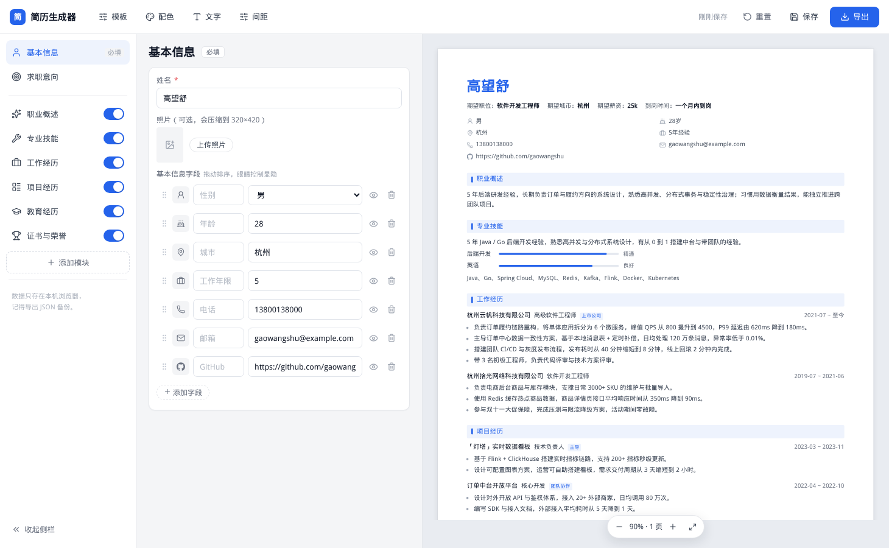

# 简历生成器 · ResumeForge

自用的网页简历编辑器：左侧选模块 → 中间填写 → 右侧 A4 实时预览 → 一键下载 PDF / PNG / JSON。
数据只存本机浏览器，不登录、不上传、不收费。



## 跑起来

```bash
npm install
npm run dev          # 本机：http://127.0.0.1:5173
npm run dev:lan      # 局域网：http://<本机IP>:5173
```

`npm run dev` 会同时起两个进程：

- `web`：Vite 开发服务器（5173）
- `api`：本地导出服务（3001），提供矢量 PDF

只想要静态站点也可以：`npm run build`，把 `dist/` 丢到任意静态托管。
此时 PDF 会退化成位图（文字不可选中），PNG 和 JSON 不受影响。

生产模式（单进程，静态 + 导出）：

```bash
npm run build
npm start          # http://127.0.0.1:3001
```

## 功能

- **模块**：基本信息、求职意向、职业概述（个人优势）、专业技能、工作经历、项目经历、教育经历、证书与荣誉，外加自定义模块。
- **基本信息字段**：姓名 / 照片 + 一个可维护的字段列表。默认有性别、工作年限、电话、邮箱，其余（年龄、城市、地址、生日、个人网站、各社交平台…）自行添加。每行可拖动排序、点眼睛在简历上显示/隐藏；带图标，链接类导出 PDF 后可点击。
- **编辑**：侧栏显示开关 + 拖拽排序；模块的上移/下移/删除在表单标题右侧；支持增删条目；工作描述、技能概述、自我评价都是富文本（加粗/斜体/下划线/列表/对齐），可全屏编辑。
- **时间**：年月用自绘面板（年份 + 三列月份），不用原生月份控件；结束时间留空即「至今」，没有勾选框；条目时间可放左侧或最右侧。
- **预览**：A4 等比缩放，自动分页参考线；侧栏可收起，腾出预览空间。
- **主题**：主题色、黑体/宋体、字号、行距、模块间距、页边距、是否显示照片、条目时间位置。
- **导出**：
  - PDF：服务在 → 矢量（文字可选中）；服务不在 → 位图（一键下载，无对话框）
  - PNG：2 倍清晰度，多页自动打包 zip
  - JSON：备份 / 换机 / 导入还原
  - 打印：`Cmd/Ctrl+P` 或菜单里的「打印 / 另存为 PDF」，同样是矢量
- **持久化**：改动 500ms 防抖写入 IndexedDB，`Cmd/Ctrl+S` 立即保存。
- **重置**：顶栏「重置」把内容恢复成示例骨架（虚构人物「高望舒」，软件开发岗），模板与配色保留；重置前会确认。

## 导出是怎么工作的

一套 DOM，两种输出，不写第二份排版：

```
浏览器 PreviewPane（缩放）  ─┐
浏览器 ExportRoot（1:1 离屏）├─ 同一个 ResumeDocument
导出页 #/export（1:1）      ─┘
        │
        ├─ PNG        html-to-image → canvas → 切片
        ├─ 位图 PDF   canvas → jsPDF（文字不可选中）
        └─ 矢量 PDF   POST /api/export → 无头 Chromium page.pdf()
```

矢量路径里，服务端只是「打开自己的 `#/export` 页面、注入数据、截图」，所以导出结果和预览一致是结构性保证。

## 数据在哪

- 简历：浏览器 IndexedDB（key `resume-studio:current:v1`）
- 清缓存 = 丢数据，**记得定期导出 JSON**
- 换机器：导出 JSON → 新机器「导出 → 导入 JSON」

## 部署

纯静态项目，`npm run build` 产出 `dist/`，扔到任意静态服务器即可。

部署到子路径（例如 `/resume/`）时，构建要带上前缀：

```bash
VITE_BASE=/resume/ npm run build
```

nginx 示例：

```nginx
location /resume/ {
    alias /var/www/resume/;
    index index.html;
}
```

也可以构建 + rsync 一条命令（服务器信息自己填）：

```bash
REMOTE=user@host REMOTE_DIR=/var/www/resume BASE_PATH=/resume/ npm run deploy
```

> 静态部署下没有本地导出服务，PDF 会自动退化为位图；需要矢量 PDF 时在本机 `npm run dev` 使用。

## 配置

可选。`.env` 只服务于本地导出用的 Chromium：

```
PLAYWRIGHT_BROWSERS_PATH=/path/to/ms-playwright/browsers
LD_LIBRARY_PATH=/path/to/libs
PORT=3001
APP_ORIGIN=http://127.0.0.1:5173
```

不配置也能用：PDF 走位图，编辑、保存、PNG、JSON 都不受影响。

没装 Chromium 的话：

```bash
npm i -D playwright && npx playwright install chromium
```

然后把 `PLAYWRIGHT_BROWSERS_PATH` 指向 `~/Library/Caches/ms-playwright`（macOS）或 `~/.cache/ms-playwright`（Linux），或者直接删掉这一行用默认缓存。

## 校验

```bash
npm run typecheck     # 类型
npm run check         # 需要 dev 在跑：交互冒烟 + 三种导出回归
```

`check-export.mjs` 会真的下载 PNG / 矢量 PDF / 位图 PDF，检查尺寸、字体流和「不是白纸」。

## 目录

```
shared/schema/     数据模型、示例、归一化/导入校验
shared/util/       富文本白名单、纯文本转换
src/app/           顶栏、侧栏、快捷键
src/editor/        表单、富文本、字段组件
src/preview/       ResumeDocument、预览、离屏/打印根
src/templates/     模板注册表（目前一套：minimal-blue）
src/export/        JSON / PNG / 位图 PDF / 矢量 PDF
server/            Hono + playwright-core 导出服务
```

## 已知限制

- 目前只有一套模板，但注册表和切换入口已就绪。
- 没有撤销/重做、版本快照、多份简历管理（都是 M4/M5）。
- 位图 PDF 的文字不可选中；ATS 解析建议用矢量 PDF。
- 多页时 PNG/位图 PDF 按 A4 高度硬切片，跨页的文字行可能被切断；矢量 PDF 由浏览器分页，不受影响。
- 字体用系统字体栈，换机器可能变成别的字体（后续可自托管思源黑体）。
- 移动端只能看，不适合编辑。
