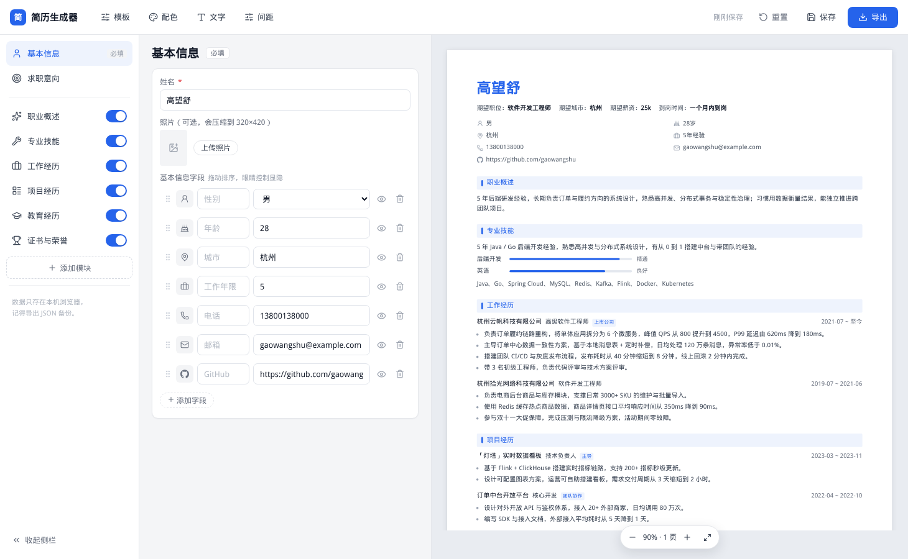
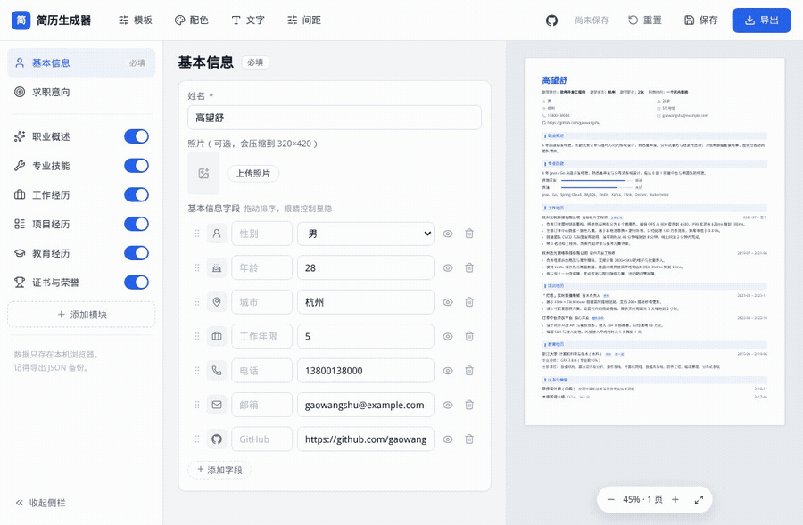
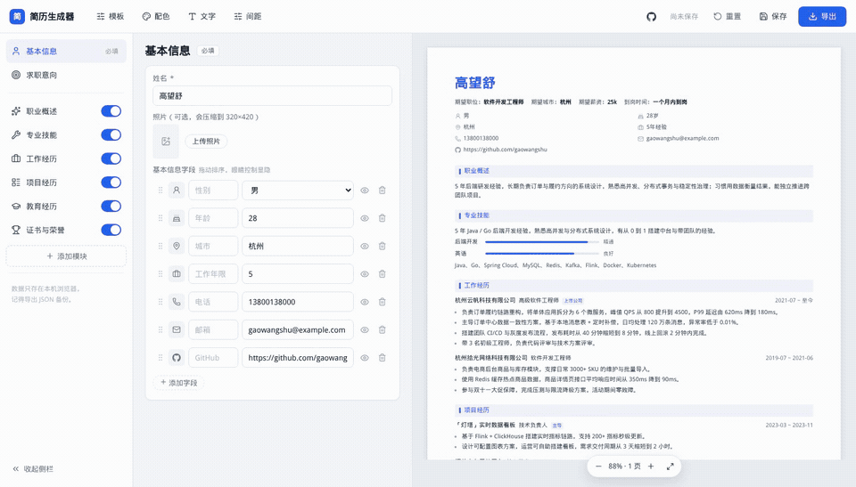
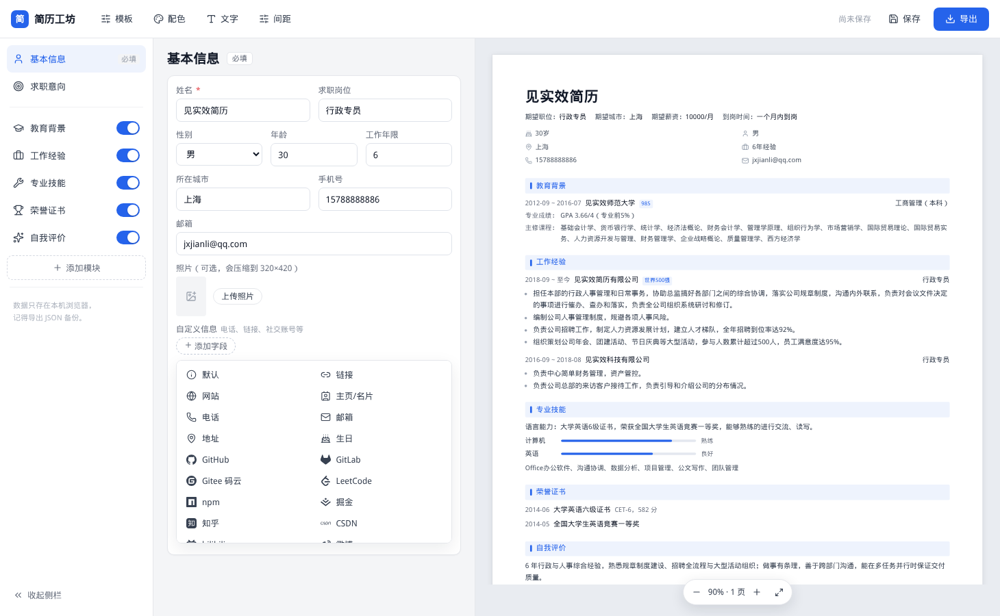
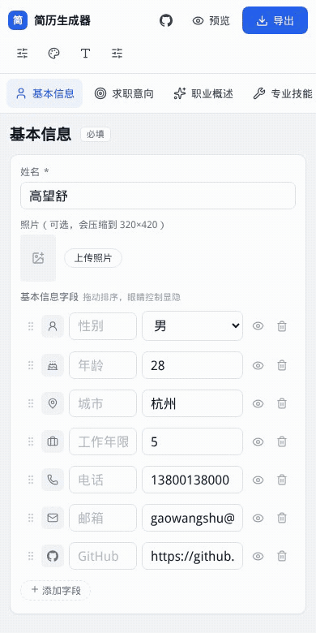

# 给自己写一个简历生成器：不想再和 Word 排版较劲

> 一个本地优先的简历编辑器：数据只留在浏览器里，能导出 PDF / PNG / JSON，模板和字段都能自己改。
>
> 标签建议：前端、React、开源、个人项目

每次改简历，我都要在 Word 里跟页边距、文本框和分页符搏斗一晚上。更麻烦的是，一旦想调整结构——比如把「教育经历」挪到「项目经历」后面——整份文档的格式就会重新崩一次。

也试过市面上的在线简历工具，问题在于：模板要会员、导出要会员、字段逻辑不能改，而且简历这么私人的东西存在别人服务器上，总觉得不太对劲。

于是干脆自己写了一个。需求很简单：**打开网页填内容，右边实时看到 A4 排版，填完直接下载 PDF。** 数据不经过任何服务器。

## 它长什么样

打开就是三栏：左边是模块列表，中间是表单，右边是 A4 预览。



模块可以拖动排序，顺序会实时反映到右边的简历上：



配色也是全局的——换一个主题色，姓名、板块标题、标签、技能条会一起变：



除了排序，每个模块都能用眼睛图标控制显隐；基本信息里的性别、年龄、城市、电话也都是字段，可以自己增删，还能加 GitHub、知乎、个人网站这类带图标的链接字段：



窄屏（≤900px）会自动换成另一套布局：顶部横向模块条 + 编辑区，预览收起来，点右上角「预览」全屏查看：



## 定下的几条规则

**1. 内容与表现分离。**
一份简历就是一个 JSON 对象：基本信息、求职意向、教育、工作、项目、技能、证书、自定义模块。模板只负责把这些数据画出来。换模板不会动内容，改内容也不会破坏排版。

**2. 一套 DOM，多种输出。**
预览、离屏导出、打印，用的是同一个 `ResumeDocument` 组件，只是实例化了三次。这样"预览好看、导出错位"这类问题从结构上就不会发生，而不是靠两套代码去对齐。

**3. 静态优先，后端可选。**
整个应用是一个纯静态站点，不需要数据库、不需要登录。但浏览器没有"把 DOM 静默转成矢量 PDF"的能力——`window.print()` 会弹对话框，jsPDF 那套只能出位图。

所以做了双路径：默认走 canvas + jsPDF 的位图 PDF（一键下载、零依赖）；如果能连上本机一个可选的导出服务，就自动升级成无头 Chromium 的 `page.pdf()`，文字可选中、字体子集嵌入。这个服务只监听 127.0.0.1，公开部署时不会带上去。

**4. 数据自持。**
简历存在浏览器的 IndexedDB 里，自动保存，另外可以随时导出 JSON 备份、换机器导入。没有账号，也没有云同步——这是取舍，不是遗漏。

## 几个实际踩过的坑

**导出一张白纸。** 导出用的离屏节点是 `position: fixed; left: -20000px`，`html-to-image` 会把计算样式一起克隆进 SVG，结果整页内容被移出了画布。修法是在截图时用 `style` 把克隆体拉回 `0,0`。后来回归脚本里加了个"墨迹比例"断言，防止再犯。

**中文字体。** 打印前必须 `await document.fonts.ready`，否则字体回退会让换行位置和预览不一致。现在用的是系统字体栈，换机器字形会变，自托管思源黑体是待办。

**打印丢背景。** 板块标题的浅色底、标签的彩色底，得靠 `print-color-adjust: exact` 才能印出来。

**分页。** 矢量 PDF 交给浏览器按 `@page` 分页，条目加 `break-inside: avoid`；位图 PDF 是按 A4 高度硬切的，跨页的文字行可能被切断，这是已知限制。

**iOS 输入框缩放。** 输入框字号小于 16px，Safari 聚焦时会自动放大页面，移动端适配时统一提到 16px。

**触屏拖拽。** HTML5 拖放不支持触屏，所以移动端模块排序靠表单标题旁的上下箭头，字段排序暂时只能回桌面改。这个还没修。

## 导出能力一览

| 格式 | 文字可选中 | 需要本地服务 |
| --- | --- | --- |
| 矢量 PDF | ✅ | ✅ |
| 位图 PDF | ❌ | ❌ |
| PNG（2 倍图，多页打 zip） | — | ❌ |
| JSON（备份 / 迁移） | — | ❌ |
| 打印 / 另存为 PDF | ✅ | ❌ |

## 一个附加功能：导出「可填写 HTML」

调整好模块、字段、配色和边距之后，可以把当前版式导出成一个**单文件 HTML**：

- 布局、字段、主题全部固化，内容清空；
- 双击用浏览器打开就能填，不联网、不部署、数据只存本机；
- 填完用浏览器打印成 PDF，排版和编辑器里看到的一致；
- 没填的板块不会打印出来。

这样可以把「版式」和「内容」分开交付：我定好格式，对方只负责往里填。

## 部署

代码是一个独立的 Vite + React + TypeScript 项目，构建产物是纯静态文件。我把它挂在博客的 `/resume/` 子路径下：

```nginx
location /resume/ {
    alias /var/www/resume/;
    index index.html;
}
```

构建时带上 `VITE_BASE=/resume/`，资源路径就会自动带前缀。GitHub Actions 里跑 `typecheck + build`，发版时 rsync 一下就行。

## 适合谁

如果你也符合下面几条，可能会用得上：

- 简历不需要天天改，但每次改都不想重排格式；
- 在意数据隐私，不想把简历传到第三方；
- 想自己改模板、加字段，而不是被平台的功能边界卡住。

反过来，如果你需要"发一个链接给 HR 在线看"、多端同步、或者和别人协作编辑，这个项目并不合适——它从设计上就是单机工具。

## 最后

项目是开源的，代码在这里：**https://github.com/cy-wwyy/resume-forge**

技术栈是 React 19 + Vite + TypeScript + Zustand，导出用了 html-to-image / jsPDF，可选的矢量导出用 Hono + playwright-core。整个项目大概六千行，欢迎提 issue，或者直接 fork 一份改成自己的模板。
